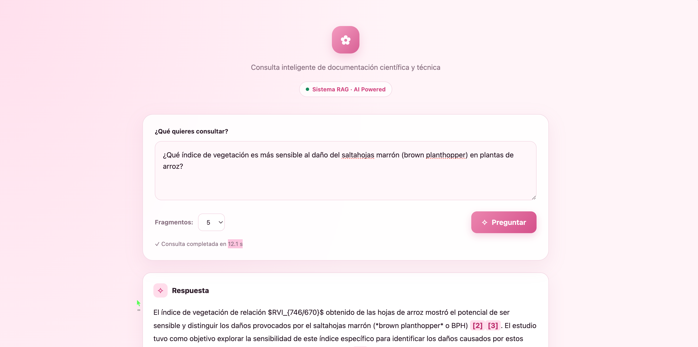
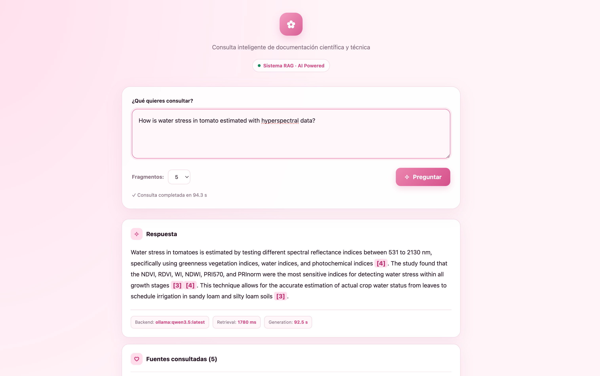

# RAG mínimo sobre documentación técnica (Ejercicio 2)
El sistema permite hacer preguntas en lenguaje natural y consultar la información de los documentos. Está disponible mediante una API con FastAPI, a través del endpoint `POST /query`, que devuelve una respuesta y las fuentes utilizadas, indicando el documento y la página.

---

## Instalación y ejecución

```bash
python -m venv .venv && source .venv/bin/activate
pip install -r requirements.txt
```

El sistema usa la API de Gemini (Google) para los embeddings y la generación. Hace falta una clave gratuita de [Google AI Studio](https://aistudio.google.com/apikey):

```bash
cp .env.example .env     
```

El repositorio incluye el índice ya construido (`index/`, 1,5 MB), así que basta con arrancar la API:

```bash
uvicorn src.api:app --port 8000
```

Para reconstruir el índice (por ejemplo si se cambian los documentos o el chunking): `python scripts/build_index.py`. Tarda uno o dos minutos: los 352 chunks se envían en lotes de 25 y el plan gratuito limita las peticiones por minuto, el script espera y reintenta.

- Interfaz web: http://127.0.0.1:8000/ · Swagger: http://127.0.0.1:8000/docs
- `GET /health` indica qué backend de generación y de embeddings está activo.

```bash
curl -X POST http://127.0.0.1:8000/query -H "Content-Type: application/json" \
  -d '{"question": "¿Qué índice de vegetación es más sensible al daño del saltahojas marrón en arroz?", "top_k": 3}'
```

Otras formas de uso: `python scripts/ask.py "pregunta"` (CLI), `pytest` (tests, no necesitan clave), `python scripts/eval_retrieval.py` (evaluación de la recuperación), `requests.http` (peticiones listas para la extensión REST Client de VS Code).

**Sin clave de API.** Si no hay `GEMINI_API_KEY`, la API arranca igualmente con el índice incluido y responde en modo extractivo con BM25 (sin LLM, devuelve los fragmentos más relevantes). También puede usarse Ollama en local (`ollama pull bge-m3` y `ollama pull qwen3.5`), reconstruyendo el índice con `RAG_EMBEDDING_BACKEND=ollama`. El índice guarda con qué modelo se construyó, y las preguntas se codifican siempre con ese mismo modelo. Se puede forzar un backend con `RAG_EMBEDDING_BACKEND` y `RAG_LLM_BACKEND` (ver `.env.example`).


##  Cómo funciona el sistema

### Extracción y limpieza

He utilizado `pypdf` para extraer el texto página por página.

Durante este proceso:
- Uno las palabras que aparecen partidas por un guion al final de línea.
- Elimino saltos de línea innecesarios.
- Guardo el nombre del documento y el número de página de cada fragmento.

Esto permite recuperar la información y mostrar después la página exacta de donde procede.

### Chunking

He dividido el texto en fragmentos de aproximadamente 1.200 caracteres, con un solapamiento de 200 caracteres.

He elegido estos valores para mantener suficiente contexto sin crear fragmentos demasiado grandes.

También he intentado cortar los fragmentos al final de una frase cuando es posible. Así, el texto que recibe el modelo es más fácil de interpretar.

Los chunks no mezclan páginas diferentes. De esta forma, puedo indicar una referencia concreta para cada resultado. La pequeña limitación es que una frase que continúa en la página siguiente puede quedar dividida.

### Embeddings

Para convertir los fragmentos en vectores utilizo **gemini-embedding-001**, a través de la API de Gemini.

He elegido este modelo principalmente porque:
- Es multilingüe: permite trabajar con documentos en inglés y preguntas en español.
- Distingue entre pasajes (`RETRIEVAL_DOCUMENT`) y preguntas (`RETRIEVAL_QUERY`), lo que mejora la recuperación.
- Permite elegir la dimensión del vector. Uso 768 dimensiones, suficiente para este corpus y con un índice más pequeño.
- No requiere instalar PyTorch ni ejecutar un modelo en local.

Los vectores están normalizados y utilizo la similitud del coseno para comparar las preguntas con los documentos.

Al principio probé `multilingual-e5-small` con `sentence-transformers`, pero esta opción necesitaba instalar PyTorch y aumentaba bastante el tamaño de las dependencias. Después utilicé `bge-m3` con Ollama, que funciona bien pero es lento en un ordenador sin GPU (unos 9 minutos para indexar). Mantengo esta opción como alternativa local cuando no hay clave de API.

### Recuperación de información

He utilizado una búsqueda híbrida que combina dos métodos:

- **Búsqueda densa:** compara el significado de la pregunta con los fragmentos mediante embeddings. Es especialmente útil cuando la pregunta está en español y el documento en inglés.
- **BM25:** busca coincidencias de palabras. Puede ser útil para encontrar términos concretos, como `NDVI`, nombres de sensores, siglas o valores numéricos.

Después combino los resultados mediante **Reciprocal Rank Fusion (RRF)**. Este método utiliza la posición de cada resultado en las dos búsquedas para crear una clasificación conjunta.

He elegido este enfoque porque los documentos contienen tanto conceptos científicos como términos y valores específicos.

Con los 352 chunks actuales, la búsqueda vectorial se realiza directamente con NumPy. No considero necesario utilizar todavía una base de datos vectorial o un índice aproximado.

### Evaluación de la recuperación

He preparado un pequeño conjunto de evaluación con 10 preguntas: dos por documento, una en español y otra en inglés.

Los resultados están guardados en `eval/results.json`; el script `scripts/eval_retrieval.py` los recalcula para el índice que esté construido. Incluyo también la medida que obtuve antes con `bge-m3` (Ollama) para comparar.

| Recuperador | Hit@1 | Hit@5 | MRR |
|---|---:|---:|---:|
| Denso (gemini-embedding-001) | 1,00 | 1,00 | 1,00 |
| BM25 | 0,80 | 0,90 | 0,83 |
| Híbrido (RRF, Gemini + BM25) | 1,00 | 1,00 | 1,00 |
| Híbrido (RRF, bge-m3 + BM25), medida anterior | 0,90 | 1,00 | 0,93 |

Los resultados muestran que la búsqueda densa ya acierta todas las preguntas en este conjunto pequeño, y el método híbrido mantiene ese resultado. Con `bge-m3` el híbrido bajaba a 0,93 de MRR por una pregunta en la que BM25 colocaba otro documento primero; con los embeddings de Gemini eso ya no ocurre.

Hay una limitación importante: las preguntas están relacionadas con los títulos de los artículos y no incluyen suficientes consultas con cifras, siglas o nombres técnicos concretos. Por eso, todavía no puedo demostrar que BM25 aporte una mejora real.

Mantendría esta combinación como primera aproximación, pero ampliaría las preguntas de evaluación antes de decidir si merece la pena conservarla o modificar el peso de cada método.

### Generación de respuestas

Para generar las respuestas utilizo **Gemini 3.5 Flash** mediante la API de Gemini, con temperatura baja (0,1) y el modo de razonamiento (*thinking*) desactivado, porque la respuesta es corta y debe limitarse a los fragmentos. Con esa configuración cada respuesta tarda entre uno y cuatro segundos; con el razonamiento activado tardaba entre 3 y 8 segundos sin mejorar la respuesta. Si la API devuelve 429 o 503 (cuota del plan gratuito o modelo saturado) se reintenta con espera creciente.

El modelo recibe la pregunta y los fragmentos recuperados. El prompt establece algunas reglas:

- Responder utilizando únicamente la información de los fragmentos.
- Mantener el idioma de la pregunta.
- Incluir referencias como `[1]` después de las afirmaciones.
- Indicar cuando la información no aparece en los documentos.

La API devuelve la respuesta junto con las fuentes. Cada fuente incluye el documento, la página y un campo `cited` que indica si se ha utilizado en la respuesta.

El backend se elige automáticamente según lo que esté disponible: Gemini si hay clave, si no un modelo local con Ollama (`qwen3.5`), y si tampoco hay, un modo extractivo que devuelve los fragmentos más relevantes sin LLM. Así la API siempre responde.
### Escalabilidad: corpus 100 veces más grande

Si el corpus aumentara 100 veces, sustituiría la búsqueda vectorial directa con NumPy por una base de datos vectorial o un índice ANN, como FAISS o Qdrant, para reducir el tiempo de recuperación.

También revisaría el proceso de ingesta para permitir el procesamiento por lotes, la actualización incremental del índice y el almacenamiento persistente de los embeddings.

Ampliaría el conjunto de evaluación con más preguntas representativas y mediría el rendimiento y el coste de cada etapa del pipeline.

### Comparación de rendimiento: backend local vs API

He comparado el tiempo de respuesta utilizando los dos backends disponibles:

| Backend | Tiempo de respuesta |
|---|---:|
| Ollama (local) | 94,3 s |
| Gemini API | 12,1 s |

En esta prueba, Gemini API fue aproximadamente 7,8 veces más rápido que Ollama ejecutándose localmente, reduciendo el tiempo de respuesta alrededor de un 87,2 %.

La diferencia se explica principalmente por las limitaciones de recursos del equipo al ejecutar el modelo localmente, especialmente al no disponer de GPU dedicada.

Por este motivo, utilizo Gemini como backend principal y mantengo Ollama como alternativa para ejecutar el sistema sin depender de una API externa.

Estos resultados corresponden a una prueba concreta y pueden variar según el modelo, el hardware, la longitud de la pregunta y la carga del servicio.
## 3. Interfaz de la API

### Consulta del sistema RAG





## Uso de IA
He usado Claude (Claude Code) como asistente durante el ejercicio.
**Generado o resuelto con ayuda del asistente:**
- El código de ingesta, chunking, recuperación híbrida, backends de generación, API FastAPI, scripts y
  tests. Yo definí la arquitectura y las decisiones; el asistente escribió la mayor parte del código y yo lo revisé y probé.
**Razonamiento y decisiones mías:**

- Usar la API de Gemini para embeddings y generación, manteniendo alternativas sin clave (Ollama en local) y un modo extractivo, para que cualquiera lo pueda levantar siguiendo el README.
- Los parámetros de chunking (tamaño, solapamiento, no cruzar páginas) y la elección de un modelo de embeddings multilingüe, evitando dependencias pesadas como torch.
- Las preguntas del conjunto de evaluación y la lectura de sus resultados.
- Recuperación híbrida con RRF en lugar de solo embeddings, por el tipo de texto (siglas, cifras).
- Que cada fuente lleve página y un indicador de si fue citada, para que la respuesta sea verificable.
